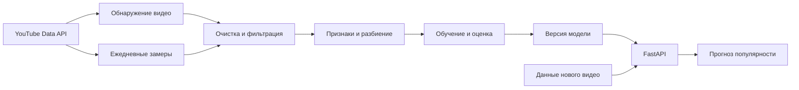

<div align="center">

<h1>BeautyReach · Popularity Prediction</h1>

<p><strong>Сервис прогнозирования популярности англоязычных Beauty-видео на YouTube</strong></p>

<p>Годовой проект магистратуры «Искусственный интеллект» · 2026–2027</p>

<p><strong>Команда 127</strong> · Тема № 84 · ML → FastAPI → Deep Learning</p>

</div>

---

> **Идея проекта:** оценивать потенциальную популярность Beauty-видео до публикации по его содержанию, метаданным и истории канала. К декабрю 2026 года — работающий MVP на FastAPI; к июню 2027 года — итоговый сервис с проверенной моделью и воспроизводимыми экспериментами.

**Статус:** планирование и сбор данных. Описанные ниже объёмы, модели и возможности сервиса являются планом работ; фактические результаты добавляются по мере прохождения чекпойнтов.

**Площадка:** YouTube (Data API v3), включая Shorts. Решение принято 5 октября 2026 года, обоснование — в разделе «Выбор площадки».

<p align="center">
  <a href="#about">О проекте</a> ·
  <a href="#platform">Выбор площадки</a> ·
  <a href="#team">Команда</a> ·
  <a href="#data">Данные</a> ·
  <a href="#ml">ML-задача</a> ·
  <a href="#stack">Стек</a> ·
  <a href="#roadmap">План работы</a> ·
  <a href="#deliverables">Результат</a>
</p>

<a id="about"></a>

## 🎯 О проекте

**Итоговая тема:** «Сервис прогнозирования популярности англоязычных Beauty-видео на YouTube».

**Цель** — разработать и исследовать ML-сервис, который прогнозирует результат нового видео и помогает автору понять, выстрелит ли ролик относительно его обычного уровня.

**Пользователи:** авторы контента, Beauty-бренды и креативные агентства, выбирающие ролики и форматы для публикации.

**Исследовательский вопрос:** насколько характеристики контента — заголовок, описание, теги, формат, длительность, время публикации — улучшают прогноз по сравнению с моделью, учитывающей только историю канала?

Для ответа на него команда планирует:

1. Сформировать выборку англоязычных Beauty-видео и описать ограничения её покрытия.
2. Провести EDA, зафиксировать целевую переменную и протокол оценки без утечки данных.
3. Сравнить простые базовые решения, классические ML-модели и нейросетевые подходы.
4. Реализовать инференс через FastAPI и подготовить демонстрацию сервиса.
5. Обеспечить воспроизводимость экспериментов и проанализировать ошибки модели.

<a id="platform"></a>

## 🔍 Выбор площадки

Исходная формулировка темы № 84 допускает TikTok или YouTube. Команда выбрала YouTube по следующим причинам.

**Доступ к данным.** TikTok Research API выдаётся по заявке только некоммерческим академическим институциям в США, EEA, Великобритании, Швейцарии и Бразилии; Россия в список регионов не входит, коммерческие организации не подпадают под критерии. Даже при одобрении квота составляет 1000 запросов в сутки без возможности расширения, а рассмотрение заявки занимает от недель до месяцев. Сбор данных TikTok в обход API нарушает условия использования платформы и не может быть представлен на защите.

**YouTube Data API v3** не требует заявки и одобрения: достаточно проекта в Google Cloud и ключа. Квота — 10 000 единиц в сутки на проект. Стоимость вызовов распределена удобно для нашей задачи: `videos.list` стоит 1 единицу и принимает до 50 ID за запрос, `playlistItems.list` — 1 единицу за страницу, а дорогой `search.list` (100 единиц) с 1 июня 2026 года вынесен в отдельную суточную корзину и не расходует общий пул.

**Почему это важно для постановки.** Поиск новых видео делается один раз и стоит дорого, а повторное измерение статистики — дёшево и батчами. Именно такой профиль затрат нужен для наблюдения когорты на фиксированном горизонте. Кроме того, историю загрузок канала на YouTube можно получить дешёвым обходом плейлиста uploads — без неё не строится базовая модель «только история автора», с которой мы сравниваем вклад контента.

**Что мы теряем.** На TikTok выдача сильнее завязана на алгоритм и слабее на число подписчиков, поэтому вклад самого контента там выше, и исследовательский вопрос звучал бы чище. Частично это компенсируется включением Shorts — вертикального короткого формата с алгоритмической лентой — и выбором относительной целевой переменной, которая снимает влияние размера канала.

<a id="team"></a>

## 👥 Команда 127

| Поповичева София Александровна | [@iamsonchous](https://t.me/iamsonchous) |
| Вайсгерберг Максим Алексеевич | [@wwwaysgerberg](https://t.me/wwwaysgerberg) |
| Мирзаи Александр Бехнамович | [@boklealex](https://t.me/boklealex) |
| Беляевский Илья Евгеньевич | [@elayyya](https://t.me/elayyya) |

**Куратор:** Хамрин Роман.

Четыре направления работ: сбор и качество данных; EDA и признаки; моделирование; сервис и воспроизводимость. Раз в неделю — синхронизация по результатам, задачам и рискам; перед каждым чекпойнтом — совместная проверка материалов.

<a id="data"></a>

## 📊 Выборка и данные

### Границы исследования

| Параметр | Рабочая постановка |
| :--- | :--- |
| Платформа | YouTube (Data API v3), обычные видео и Shorts |
| Единица наблюдения | Одно публичное видео; повторные измерения статистики хранятся отдельными строками |
| Язык | Английский; определение по заголовку, описанию и языковым полям API |
| Вертикаль | Beauty & Personal Care |
| Категории | Skincare, Makeup, Haircare, Fragrance, Body / Personal Care, Nails / Lashes / Brows |
| Формат | Отдельный признак: Shorts или обычное видео |
| География | Ориентир: США, Великобритания, Канада, Австралия; трактуется по полям API и уточняется после пилота |
| Окно наблюдения | Проспективная когорта: видео, опубликованные с 7 октября 2026 года и отслеживаемые по расписанию |
| Архивное окно | Видео, опубликованные ранее, — только для EDA и вспомогательных экспериментов |
| Объём к EDA (27.10) | Ориентир 30–60 тыс. очищенных записей, из них когорта с полным горизонтом — меньше |
| Объём к MVP (15.12) | Ориентир 100–200 тыс. записей |
| Объём к марту | Ориентир 300–600 тыс. записей; уточняется по фактической скорости сбора |

**Объём измеряется в видео, а не в просмотрах.** Целевые размеры выборки не являются требованиями чекпойнтов и пересматриваются по фактической пропускной способности сбора. Квота считается на проект Google Cloud; официальный путь получить больше — форма расширения квоты с аудитом, но рассмотрение длительное и одобрение не гарантировано, поэтому план строится на базовой квоте.

### Принцип сбора

Сбор состоит из двух независимых контуров.

**Контур обнаружения.** Поиск по наборам Beauty-ключевых слов и хэштегов, а также обход каналов, найденных на предыдущих итерациях. Расходует отдельную суточную корзину поисковых вызовов, поэтому запускается по расписанию с фиксированным бюджетом запросов в день. После объединения результатов выполняются дедупликация по `video_id`, проверка языка и тематическая фильтрация с ручной проверкой части выборки.

**Контур измерения.** Все обнаруженные видео ставятся на ежедневный замер статистики батчами до 50 ID за запрос. Этот контур дешёвый и позволяет вести большое число роликов одновременно. Именно он формирует целевую переменную на фиксированном горизонте.

Сбор обоих контуров запускается немедленно, не дожидаясь окончания пилота: просмотры на седьмой день нельзя восстановить задним числом, и каждый день без наблюдения — безвозвратно потерянные данные.

Для контроля перекосов используются страты **неделя × формат × Beauty-категория × размер канала**. Доли определяются после пилота, распределения и покрытие фиксируются в отчёте. Нижний порог просмотров не применяется: в обучении должны быть и малопопулярные, и успешные ролики. Вклад крупных каналов контролируется, чтобы несколько авторов не определяли весь датасет.

Стратификация помогает контролировать состав данных, но сама по себе не доказывает репрезентативность относительно всего YouTube; ограничения покрытия описываются явно.

### Группы полей

| Группа | Примеры | Использование |
| :--- | :--- | :--- |
| Идентификаторы и время | `video_id`, `channel_id`, `published_at`, `observed_at` | Дедупликация, контроль возраста видео, временное разбиение |
| Содержание и метаданные | Заголовок, описание, теги, длительность, категория, формат, время публикации | Основные признаки MVP |
| История канала | Число подписчиков, частота публикаций, статистика предыдущих видео | Только значения, доступные до момента прогноза |
| Статистика результата | Просмотры, лайки, комментарии и время каждого замера | Целевая переменная и EDA; не входы прогноза до публикации |
| Мультимодальные данные | Превью (thumbnail), субтитры, аудиопризнаки, эмбеддинги | Эксперименты второго семестра |

Наличие каждого поля проверяется на пилоте. Значения, которые нельзя восстановить на дату публикации, исключаются из исторической оценки модели. Мультимодальные признаки обрабатываются на отдельной подвыборке и не требуют загрузки всех исходных роликов.

<a id="ml"></a>

## 🧠 ML-постановка

### Целевая переменная

Основная задача — **регрессия относительной популярности**. Чтобы снять влияние размера канала и сделать видео разных авторов сопоставимыми:

```text
y_rel = log( (views_H + 1) / (median_previous_views_H + 1) )

views_H — просмотры через H дней после публикации
median_previous_views_H — медиана по предыдущим видео того же канала,
                          результаты которых уже были известны к моменту прогноза
```

Это и есть прямая форма исследовательского вопроса: объясняет ли содержание ролика, почему одно видео канала выстреливает, а другое нет. При недостаточной истории канала используется заранее определённый резервный вариант по категории и формату, рассчитанный только на обучающих данных.

Вспомогательная цель — **абсолютная популярность** для сопоставимости с внешними работами:

```text
y_abs = log(1 + views_H)
```

**Горизонт H = 7 дней** — рабочая гипотеза, проверяемая на пилоте по фактической частоте и стабильности замеров. Допустимое отклонение времени измерения фиксируется до обучения.

Накопленная статистика архивных видео не является просмотрами на седьмой день и используется только для EDA и отдельно обозначенных предварительных экспериментов.

### Модели и оценка

| Уровень | Планируемые подходы | Что проверяем |
| :--- | :--- | :--- |
| Baseline | Константный прогноз; историческая медиана канала | Качество без анализа содержания ролика |
| Первые ML-модели | Ridge / линейная регрессия, Random Forest, CatBoost | Пользу метаданных и текстовых признаков |
| Улучшение ML | Подбор гиперпараметров; CatBoost и при необходимости LightGBM / XGBoost | Влияние признаков, очистки и объёма данных |
| Нейросети | MLP для табличных признаков; текстовый энкодер для заголовка и описания; объединение текста и эмбеддингов превью | Добавочную ценность архитектур и модальностей |

**Основная метрика:** MAE на целевой шкале. Дополнительные — RMSE, MAE в просмотрах для абсолютной цели и ранговая корреляция Спирмена. Результаты сравниваются на одинаковых разбиениях и сопоставимом наборе объектов; качество по категориям, форматам и размерам каналов приводится отдельно.

Протокол оценки включает:

- **Временное разбиение:** обучение на более ранних публикациях, валидация и тест на более поздних; к дате обучения все используемые целевые значения уже должны быть доступны.
- **Проверку на новых каналах:** отдельный тест без пересечения `channel_id` с обучением.
- **Защиту от утечек:** статистика самого ролика после публикации не попадает в признаки; связанные дубли не распределяются по разным частям данных.
- **Честный подбор:** преобразования обучаются на train, гиперпараметры выбираются по validation; итоговый test сохраняется для финальной оценки.
- **Анализ ошибок:** качество по стратам, слабопредсказуемые случаи, устойчивость к пропускам; объяснение признаков через SHAP.

Успех моделирования — измеримое улучшение относительно baseline при соблюдении этого протокола. Численные пороги фиксируются после первых экспериментов. Если нейросеть не улучшает результат, это отражается в выводах, а для сервиса выбирается лучшая подтверждённая модель.

<a id="stack"></a>

## 🛠 Стек и сервис

| Задача | Инструменты |
| :--- | :--- |
| Сбор данных | YouTube Data API v3, Python, планировщик задач |
| Обработка и хранение | pandas / Polars, NumPy, Parquet |
| EDA | Jupyter Notebook, Matplotlib, Seaborn |
| Классический ML | scikit-learn, CatBoost; дополнительно LightGBM / XGBoost |
| Нейросети и текст | PyTorch, Transformers / Sentence Transformers |
| API | **FastAPI**, Pydantic, Uvicorn |
| Эксперименты и артефакты | **MLflow**, конфигурации запусков, версии датасетов и моделей |
| Воспроизводимость и качество | Git / GitHub, Docker, фиксированные зависимости, pytest |
| Демонстрация | Интерактивная документация API; простой интерфейс при наличии времени |

Конкретные библиотеки и версии фиксируются при реализации. FastAPI и MLflow включены в соответствии с требованиями чекпойнтов.



### Структура репозитория

```text
.
├── README.md
├── requirements.txt
├── .gitignore
├── config/              # конфигурации сбора, признаков, экспериментов
├── data/                # локальные данные (в репозиторий не коммитятся)
├── src/
│   ├── collect/         # обнаружение видео и ежедневные замеры
│   ├── features/        # построение признаков
│   ├── models/          # обучение и оценка
│   └── api/             # FastAPI-сервис
├── notebooks/           # EDA и эксперименты
└── tests/               # pytest
```

Запуск описывается в этом разделе по мере готовности компонентов: установка зависимостей, переменные окружения с ключом API, команды сбора, обучения и запуска сервиса.

**MVP к 15 декабря:** API принимает заголовок, описание, теги, длительность, формат, категорию, планируемое время публикации и доступную историю канала; применяет сохранённую обработку и модель; возвращает прогноз, используемый горизонт и версию модели в JSON. Предусматриваются валидация входных данных, понятные ошибки и примеры запросов. Маршруты: `POST /predict`, `GET /health`.

<a id="roadmap"></a>

## 🗓 План работы: октябрь 2026 — июнь 2027

План согласован с документом **«Чекпойнты по годовому проекту на 1 курсе магистерской программы "Искусственный интеллект", 26/27 учебный год»**, ML-трек.

> Для чекпойнта 1 указан дедлайн, для чекпойнтов 2–6 и защит — ориентировочные сроки. Отдельная дата чекпойнта 7 не задана. Внутренние сроки команды служат для планирования и уточняются при обновлении официального расписания.

### Официальные контрольные точки

| Этап | Срок | Содержание и сдаваемый результат |
| :--- | :--- | :--- |
| **1. Старт и планирование** | **06.10.2026, 23:59** | Чат команды с куратором, знакомство, итоговая тема, план на год, GitHub-репозиторий и оформленный README |
| **2. Разведочный анализ данных** | **27.10.2026, 23:59** | EDA: свойства данных, связи признаков, визуализации и выводы; ноутбук и описание выборки |
| **3. Первые ML-модели** | **27.11.2026, 23:59** | Метрика, baseline и первые модели, улучшения через данные и гиперпараметры, сравнительная таблица и выводы |
| **4. ML-сервис / MVP** | **15.12.2026, 23:59** | FastAPI: приём данных, инференс обученной модели и ответ заданного формата; демонстрация и инструкция запуска |
| **Промежуточная защита** | **10–15.01.2027** | Презентация о результатах первого семестра, демонстрация MVP и план второго семестра |
| **5. Улучшение ML-модели** | **15.03.2027, 23:59** | Более сложные модели, новые признаки, увеличение и очистка данных, анализ результатов |
| **6. Нейронные сети** | **05.05.2027, 23:59** | Применение нейросетей, сравнение архитектур с классическим ML, выводы |
| **7. Финальные доработки** | Дата не задана; внутренний ориентир — **01.06.2027** | MLflow, воспроизводимость, переобучение и логирование лучшей модели, артефакты, анализ ошибок и устойчивости |
| **Итоговая защита** | **13–20.06.2027** | Презентация о работе за год, итоговые результаты, демонстрация сервиса и выводы |

Чекпойнт 4 также является домашним заданием по дисциплине «Инструменты разработки». Для чекпойнта 1 каждый участник прикрепляет ссылку на репозиторий в peer-reviewer; ссылка дублируется куратору. Выполнение чекпойнта после дедлайна оценивается в 0 баллов, поэтому внутренние проверки планируются заранее.

### Первый семестр: данные → модели → MVP

**До 6 октября · Организация и постановка**

- Оформить репозиторий и README, создать чат и провести встречу с куратором.
- Согласовать границы исследования, распределить направления работ, зафиксировать риски.
- Завести проекты Google Cloud и ключи API на всех участников.

**6–12 октября · Запуск сбора и пилот**

- **Немедленно запустить оба контура сбора.** Просмотры на седьмой день не восстанавливаются задним числом, поэтому наблюдение когорты начинается до окончания пилота.
- Проверить состав полей, фактический расход квоты и стабильность ежедневных замеров.
- Согласовать словарь Beauty-категорий, правила включения и критерии языковой фильтрации.
- К 12 октября зафиксировать протокол измерения популярности и подтвердить достижимые объёмы.

**13–27 октября · Подготовка данных и EDA**

- До 20 октября подготовить первую очищенную версию данных и оценить качество языковой и тематической фильтрации.
- Изучить просмотры, возраст видео, категории, форматы, размеры каналов, длительность, сезонность, пропуски и выбросы; отдельно описать, какая часть выборки уже имеет полный горизонт наблюдения.
- До 24 октября завершить основной ноутбук; 25–26 октября проверить воспроизводимость и выводы. Сдать EDA к 27 октября.

**28 октября — 27 ноября · Признаки и первые модели**

- До 10 ноября зафиксировать target, метрики и разбиения; подготовить обработку текста, метаданных и истории канала.
- До 15 ноября обучить baseline и простые модели; до 23 ноября — CatBoost и подбор гиперпараметров.
- 24–26 ноября проверить утечки, ошибки и устойчивость выводов; оформить сравнение и сдать чекпойнт 3.

**28 ноября — 15 декабря · FastAPI MVP**

- До 5 декабря сохранить модель вместе с обработкой признаков, определить формат запроса и ответа.
- До 10 декабря реализовать API и примеры вызовов; 11–14 декабря проверить корректные, неполные и некорректные запросы, запуск окружения и демонстрацию.
- К 15 декабря показать полный путь от входных данных до прогноза обученной модели.

**16 декабря — 15 января · Промежуточная защита**

- До конца декабря подготовить презентацию: задача, данные, EDA, модели, метрики, API и ограничения.
- В начале января провести репетицию и подготовить резервную запись демонстрации.
- На защите 10–15 января представить MVP и уточнённый план развития.

### Второй семестр: улучшение → нейросети → воспроизводимость

**16 января — 15 марта · Масштабирование и улучшение ML**

- Январь: автоматизировать обновление и контроль качества данных, расширить покрытие категорий и каналов.
- Февраль: проверить новые признаки, в том числе сезонность и характеристики заголовков; оценить вклад объёма данных.
- До 7 марта подготовить версию датасета для чекпойнта 5 с подтверждённым составом и фактическим объёмом.
- 8–14 марта сравнить улучшенные модели с baseline, провести анализ ошибок. Сдать результаты к 15 марта.

**16 марта — 5 мая · Нейросетевые эксперименты**

- Март: подготовить текстовые эмбеддинги заголовков и описаний, нейросетевую табличную модель, оценить ресурсы.
- Апрель: сравнить архитектуры; исследовать объединение текста и эмбеддингов превью, оценить вклад каждой модальности.
- До 28 апреля завершить основные эксперименты на сопоставимых данных. 29 апреля — 4 мая проверить выводы и подготовить сравнение ML и DL к 5 мая.

**6 мая — 1 июня · Финальная модель и MLflow**

- До 15 мая интегрировать выбранную модель в сервис, обновить формат ответа и демонстрацию.
- До 25 мая настроить MLflow, повторить обучение лучшей модели, сохранить параметры, метрики, артефакты, версии данных и окружения.
- До 1 июня проверить воспроизводимость, ошибки по группам, устойчивость к пропускам и работу API.

**2–20 июня · Итоговая защита**

- 2–7 июня подготовить итоговый отчёт, таблицы экспериментов, описание ограничений и обновлённый README.
- 8–12 июня провести репетиции и подготовить резервную демонстрацию.
- 13–20 июня представить результаты годового проекта и работающий сервис.

### Основные риски и действия команды

| Риск | Запланированное действие |
| :--- | :--- |
| Квоты API ограничивают скорость сбора | Разделить дорогое обнаружение и дешёвые замеры; вести бюджет запросов; пересмотреть количественные ориентиры с куратором по фактической скорости |
| Мало видео с полным горизонтом наблюдения к EDA | Сбор запущен немедленно; для EDA отдельно описывается доля записей с полным горизонтом; архивные данные используются только для разведочного анализа |
| Выборка смещена к популярным видео и крупным каналам | Контролировать страты и вклад каналов, описывать покрытие и ограничения поиска |
| Высокая стоимость обработки мультимодальных данных | Выполнять эксперименты на подвыборке, кэшировать эмбеддинги |
| Нейросети не улучшают baseline или слишком медленны | Зафиксировать результат сравнения; выбирать модель для API по качеству и времени инференса |
| Изменение условий или квот API в течение года | Фиксировать даты и условия сбора; при изменении — описывать влияние на выборку в отчёте |

<a id="deliverables"></a>

## ✅ Критерии готовности

### Декабрьский MVP

- [ ] Описаны источник, правила выборки, доступные признаки и способ измерения target.
- [ ] Подготовлен воспроизводимый EDA с выводами.
- [ ] Обучены baseline и первые ML-модели; сохранены метрики и ограничения оценки.
- [ ] FastAPI выполняет инференс и возвращает результат в согласованном формате.
- [ ] Есть инструкция запуска, примеры запросов и демонстрация полного сценария.

### Итоговый проект к июню 2027 года

- [ ] Зафиксированы версия датасета, разбиения, фактические объёмы и ограничения покрытия.
- [ ] Сопоставлены классические модели и нейросетевые архитектуры; проверена гипотеза о пользе содержания видео.
- [ ] Лучшая подтверждённая модель интегрирована в сервис.
- [ ] MLflow хранит параметры, метрики и артефакты; обучение и инференс воспроизводятся в описанном окружении.
- [ ] Выполнены анализ ошибок, проверка устойчивости и финальная оценка на отложенных данных.
- [ ] Подготовлены отчёт, презентация и демонстрация для итоговой защиты.

---

<p align="center"><strong>Команда 127 · BeautyReach · 2026–2027</strong><br>От наблюдаемой когорты до воспроизводимого ML-сервиса</p>
